<Update label="Dec 17, 2023" id="alert-policy-duplication" tags={["Integrations"]} rss={{ title: "Alert policy duplication", date: "2023-12-17" }}>
    ## Alert policy duplication

    You can now duplicate an entire alert policy with all its rules to adapt Phare to how your company needs to be alerted.

    <Frame>
        

            <iframe
                src="https://iframe.mediadelivery.net/embed/238508/0bb0e17c-909b-4b22-9889-0216cab8ccbf?autoplay=true&loop=true&muted=true&preload=true&responsive=true"
                loading="lazy"
                allow="accelerometer;gyroscope;autoplay;encrypted-media;picture-in-picture;fullscreen"
                style={{border: 0, position: 'absolute', top: 0, height: '100%', width: '100%'}}
            ></iframe>
        

    </Frame>
</Update>

<Update label="Nov 4, 2023" id="status-pages-rss-and-atom-feed" tags={["Status pages"]} rss={{ title: "Status pages RSS and ATOM feed", date: "2023-11-04" }}>
    ## Status pages RSS and ATOM feed

    Status pages now offer an incident feed in RSS and ATOM format to let your users get updates on incidents.
</Update>

<Update label="Nov 2, 2023" id="status-pages-brand-logo-and-feed-subscription" tags={["Status pages"]} rss={{ title: "Status pages brand logo and feed subscription", date: "2023-11-02" }}>
    ## Status pages brand logo and feed subscription

    You can now add your brand logo to your status page, which will be displayed in the top left corner of the page. Current and past incidents are now shown on the status page, and your users can subscribe to an RSS or Atom feed to get updates on incidents.

    <Frame>
        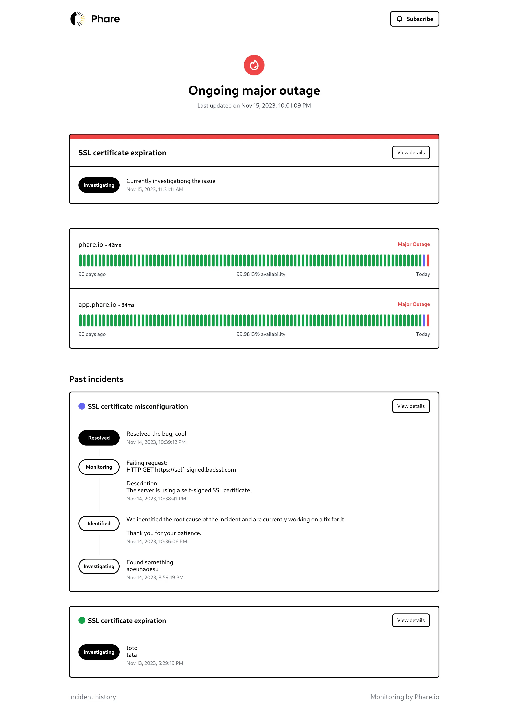
    </Frame>
</Update>

<Update label="Oct 29, 2023" id="incident-comments" tags={["Incidents"]} rss={{ title: "Incident comments", date: "2023-10-29" }}>
    ## Incident comments

    To help you resolve incidents faster, project members can now comment on the incident timeline. Comments can be written using a rich text editor, and are compatible with the Markdown syntax.

    <Frame>
        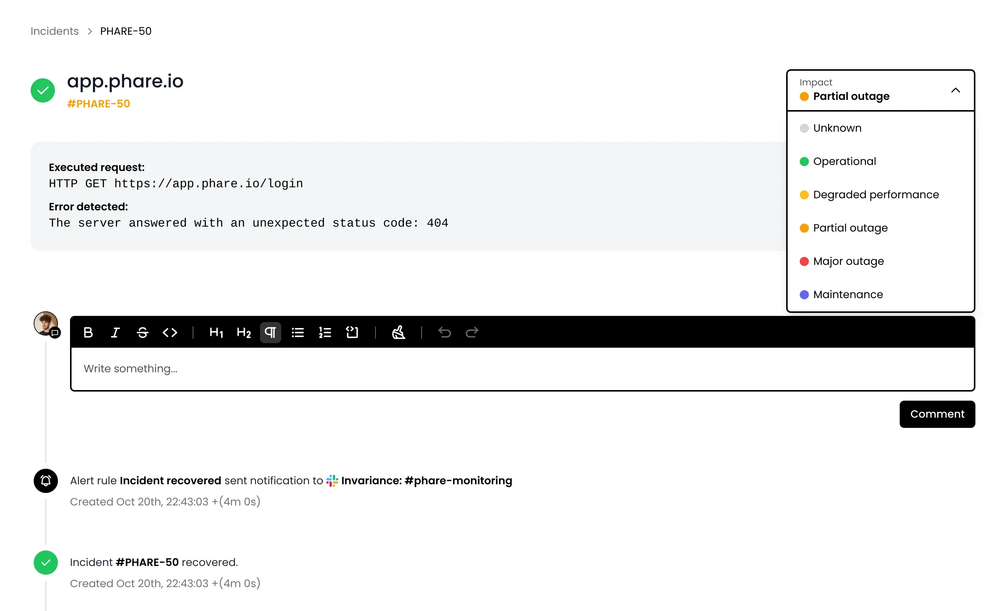
    </Frame>
</Update>

<Update label="Oct 27, 2023" id="incident-impact" tags={["Incidents"]} rss={{ title: "Incident impact", date: "2023-10-27" }}>
    ## Incident impact

    The design of the incident management page has been improved, with all actions now part of the timeline. You can now select an impact level for your incidents.

    <Frame>
        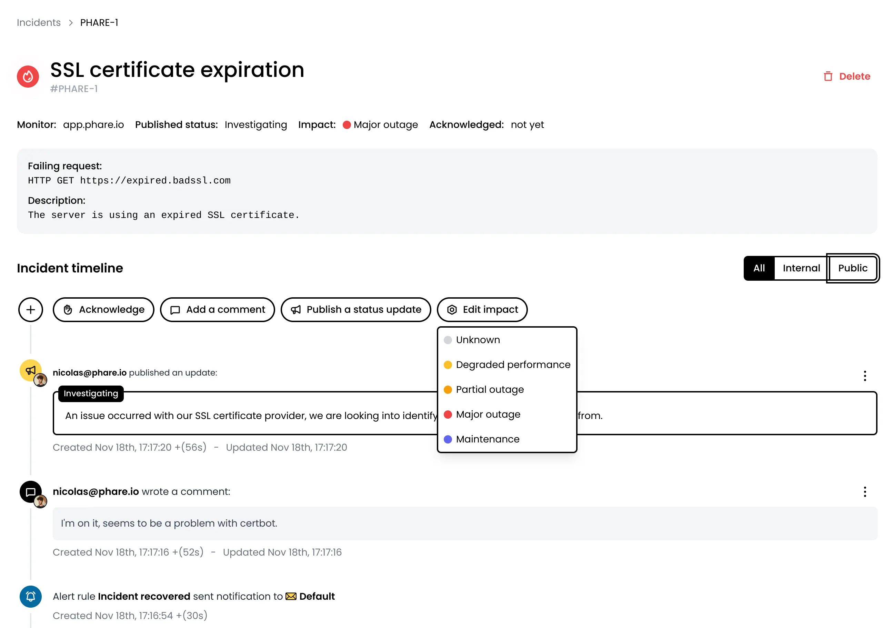
    </Frame>
</Update>

<Update label="Oct 23, 2023" id="admin-user-role" tags={["Account"]} rss={{ title: "Admin user role", date: "2023-10-23" }}>
    ## Admin user role

    A new **Admin** role is now available. This role is similar to the former **Owner** role, with the exception that it can't delete the organization, making it easier to share the management of an organization with other team members.

    You can review the available permissions of each role in the [user management documentation](https://docs.phare.io/user-management). Role can be modified on existing users, as well as directly when inviting a new user.

    <Frame>
        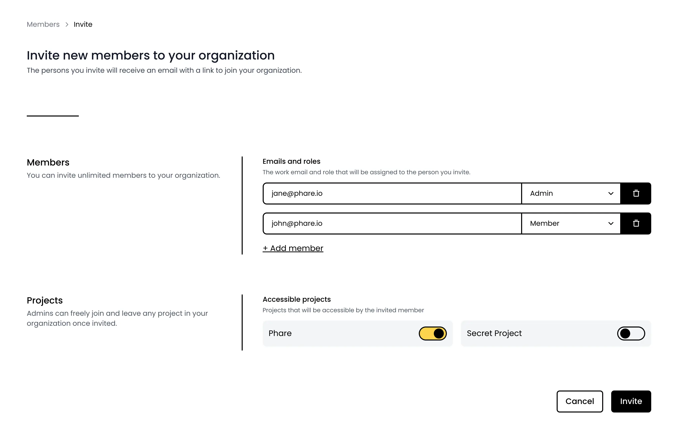
    </Frame>
</Update>

<Update label="Oct 21, 2023" id="status-pages" tags={["Status pages"]} rss={{ title: "Status pages", date: "2023-10-21" }}>
    ## Status pages

    Status pages are now available for all users, and they're **the most carbon-efficient status page on the market with an incredibly fast load time**. You can create unlimited status pages with a phare domain name, and personalize it with limited branding options.

    <Frame>
        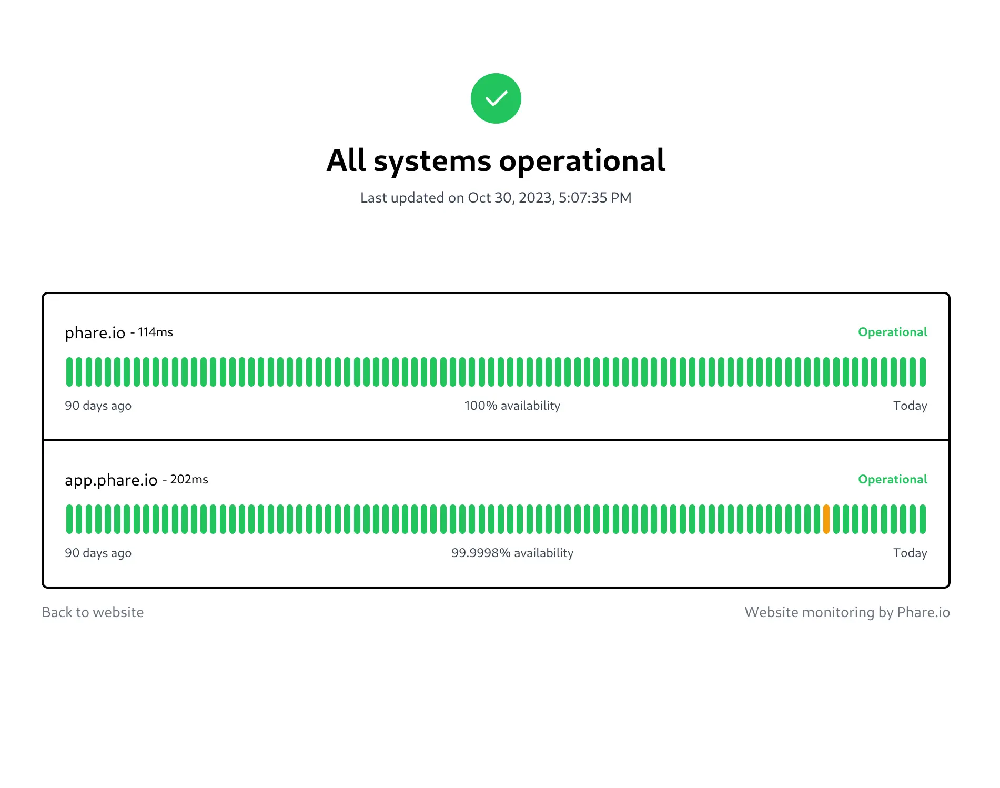
    </Frame>
</Update>

<Update label="Sep 17, 2023" id="european-mail-server" tags={["Phare news"]} rss={{ title: "European mail server", date: "2023-09-17" }}>
    ## European mail server

    The mail server used to send alert notifications has been moved to a new provider based in Europe, making Phare 100% European for non-subscribed users. This is part of Phare's commitment to privacy and data protection, using only services from companies that are headquartered in Europe and hosted in European datacenters.

    The only exception is Stripe, a US-based company used to process billing information and payments.
</Update>

<Update label="Aug 21, 2023" id="new-branding" tags={["Phare news"]} rss={{ title: "New branding", date: "2023-08-21" }}>
    ## New branding

    Bye bye MinKit and hello Phare. The platform has been renamed to Phare and has a new logo. The new name is a reference to the lighthouse, a beacon of light that helps ships navigate safely. This symbol represents Phare's mission to give a signal when it is needed so you can run high-quality production websites.

    The new name and logo are designed to feel right at home.

    The old domain name `minkit.io` will continue to work for about a year, but you should update your bookmarks and password manager as soon as possible to avoid any inconvenience in the future.

    <Frame>
        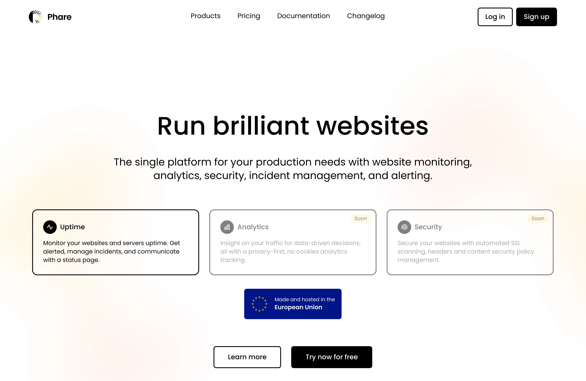
    </Frame>
</Update>

<Update label="Aug 18, 2023" id="improved-monitoring-page" tags={["Monitors"]} rss={{ title: "Improved monitoring page", date: "2023-08-18" }}>
    ## Improved monitoring page

    Visualisation of incident periods in the performance chart has been improved, and you can now get your website's average response time, cumulated downtime and availability % for the selected time period (24 hours, 7 days, 30 days or 90 days).

    <Frame>
        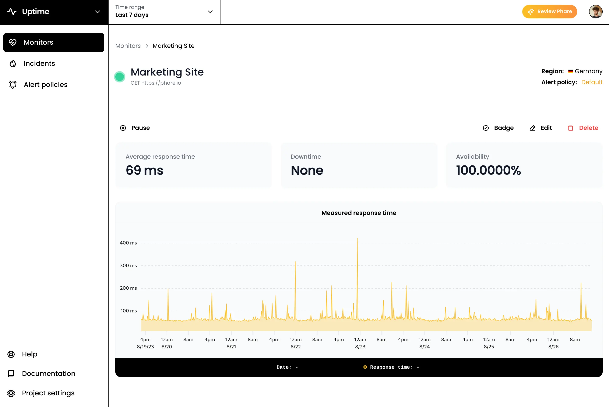
    </Frame>
</Update>

<Update label="Aug 17, 2023" id="faster-monitoring-statistics" tags={["Monitors"]} rss={{ title: "Faster monitoring statistics", date: "2023-08-17" }}>
    ## Faster monitoring statistics

    A lot of work has been done to improve the monitoring statistics. With 15M records in the database, it was starting to be a bit slow to load monitoring results by Phare's standards, because speed is a priority. [ClickHouse](https://clickhouse.com/) came to the rescue, saving up to 500ms on every page load. If you visit your monitoring page twice a day, that's 6 minutes of your life saved every year.
</Update>

<Update label="Aug 15, 2023" id="reviews" tags={["Phare news"]} rss={{ title: "Reviews", date: "2023-08-15" }}>
    ## Reviews

    A new review page has been added to the website with a list of all the places where you can leave a review of the platform. If you like Phare, please consider leaving an honest review on one of these platforms. The first 85 reviews created on Capterra will **receive a $20 gift card**!

    <Frame>
        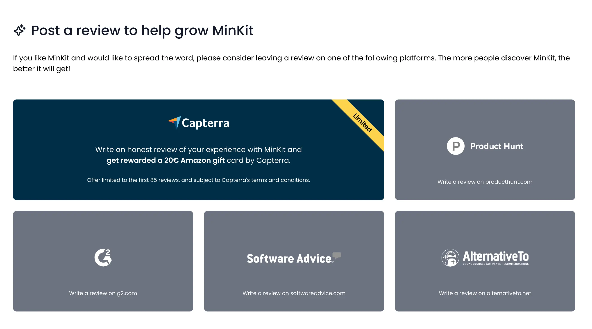
    </Frame>
</Update>

<Update label="Jul 29, 2023" id="deletion-safeguard" tags={["Account"]} rss={{ title: "Deletion safeguard", date: "2023-07-29" }}>
    ## Deletion safeguard

    A new safeguard has been added to the platform to prevent accidental deletion of important data. When you try to delete your user account, a project, or your organization, you will be asked to confirm your action with a small typing challenge. This will prevent you from accidentally deleting your account or organization.

    <Frame>
        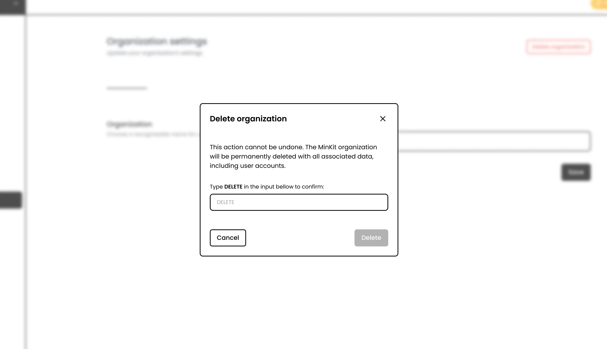
    </Frame>
</Update>

<Update label="Jul 28, 2023" id="alert-rules-duplication" tags={["Integrations"]} rss={{ title: "Alert rules duplication", date: "2023-07-28" }}>
    ## Alert rules duplication

    You can now duplicate an alert rule to rapidly create a new one with the same configuration. This is useful if you want to create a new alert rule with a similar configuration to an existing one.

    <Frame>
        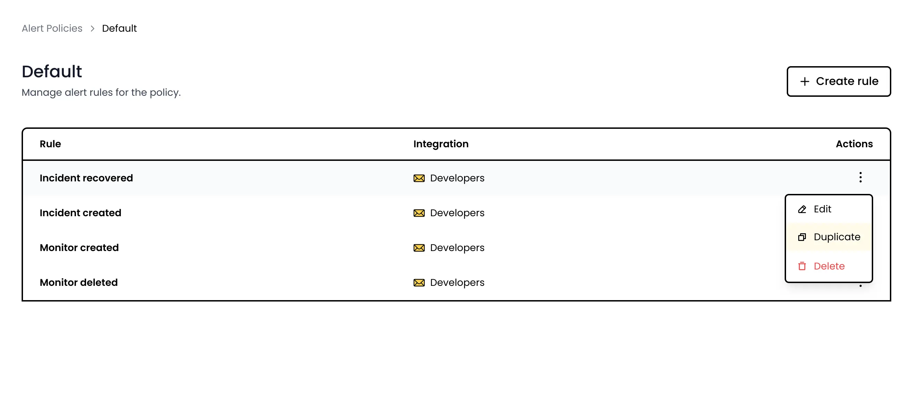
    </Frame>
</Update>

<Update label="Jun 4, 2023" id="performance-monitoring-history" tags={["Monitors"]} rss={{ title: "Performance monitoring history", date: "2023-06-04" }}>
    ## Performance monitoring history

    It is now possible to navigate the performance history of your monitors, with three available time ranges of 24 hours, 7 days and 90 days. This is a first step towards giving you more flexibility on how you view and access your monitoring data.

    <Frame>
        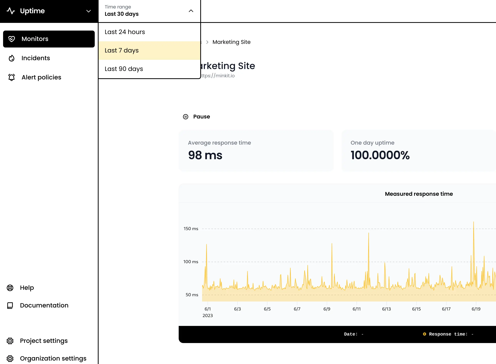
    </Frame>
</Update>

<Update label="May 29, 2023" id="improved-uptime-precision" tags={["Monitors"]} rss={{ title: "Improved uptime precision", date: "2023-05-29" }}>
    ## Improved uptime precision

    Uptime percentage is now calculated with four digits precision, allowing more accurate long-term SLA calculations. For example, 99.9999% uptime means that your service can be down for 31 seconds per year.

    Badges also got updated with four digits precision.

    <Frame>
    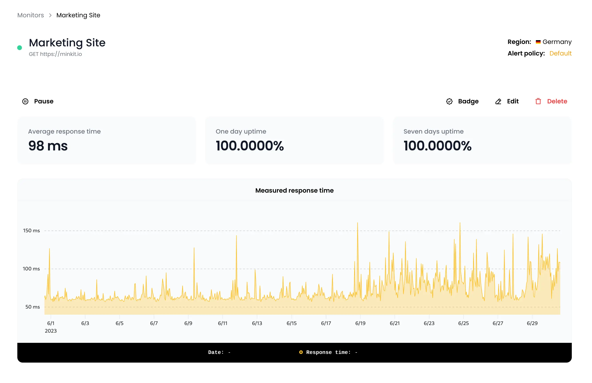
    </Frame>
</Update>

<Update label="May 27, 2023" id="incident-events-improvements" tags={["Incidents"]} rss={{ title: "Incident events improvements", date: "2023-05-27" }}>
    ## Incident events improvements

    Incident events now show more precise date and time information. With the exact time of the event, and the elapsed time since the creation of the incident.

    <Frame>
        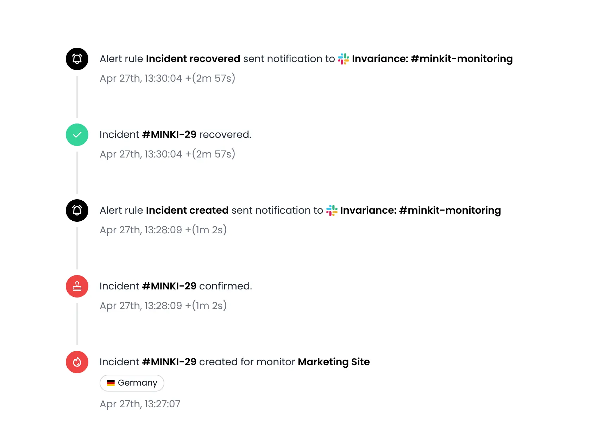
    </Frame>

    A tooltip with the exact date and time is also available on hover of all the already existing dates and times in the Phare dashboard.

    <Frame>
        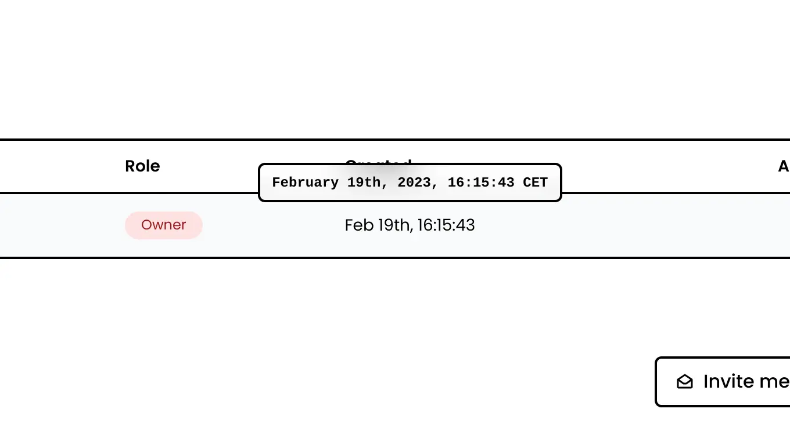
    </Frame>
</Update>

<Update label="May 17, 2023" id="multi-quota-billing-alerts" tags={["Account"]} rss={{ title: "Multi-quota billing alerts", date: "2023-05-17" }}>
    ## Multi-quota billing alerts

    A fairly technical feature, but important for the future of the platform. With the release of the SMS integration last week, Phare now offers two different billing quotas: SMS alerts and monitoring events. The billing alert system, which is responsible for sending emails when a quota is exhausted, was the last piece of the billing infrastructure that only supported monitoring events.

    In simpler terms, the platform now has the required foundation to bill anything, as part of a monthly plan or as additional usage. New features no longer require billing infrastructure changes, allowing faster releases.

    <Frame>
        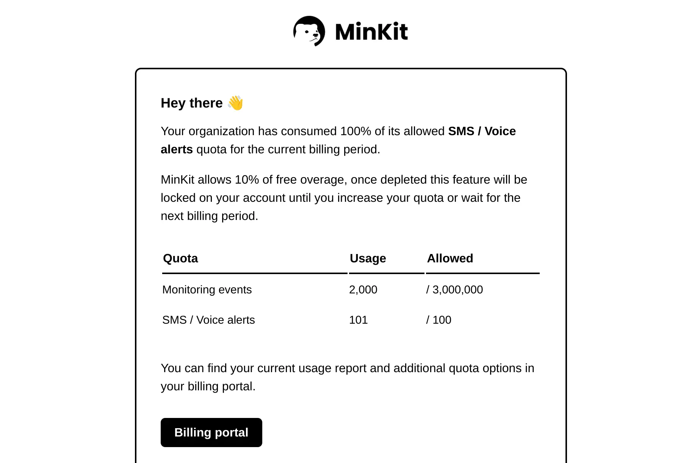
    </Frame>
</Update>

<Update label="May 14, 2023" id="integrations-documentation" tags={["Integrations"]} rss={{ title: "Integrations documentation", date: "2023-05-14" }}>
    ## Integrations documentation

    The [documentation for the integrations](https://docs.phare.io/integrations/overview) has been created, mostly to include information on the new SMS integration. You can find a few tips on configuration, supported countries, the email address and phone numbers Phare uses to send alerts, and much more.

    <Frame>
        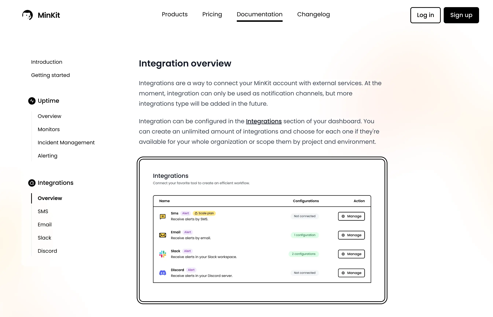
    </Frame>
</Update>

<Update label="May 13, 2023" id="sms-integration" tags={["Integrations"]} rss={{ title: "SMS integration", date: "2023-05-13" }}>
    ## SMS integration

    Phare now offers SMS alerts! You can receive SMS alerts by configuring the new SMS integration. The SMS integration is only available on the Scale plan with 100 alerts included monthly.

    <Frame>
        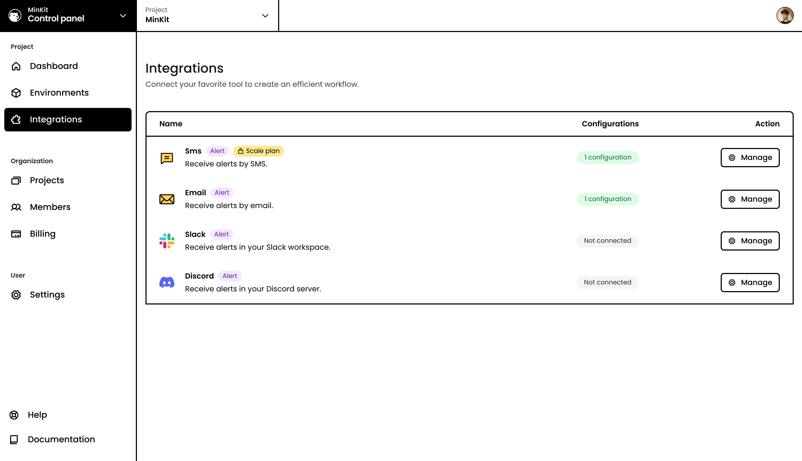
    </Frame>

    You can add a phone number to their profile, which will be used to send SMS alerts. You will have to validate your phone number by entering a code sent by SMS. Team members that do not yet confirm a phone number can still be added to the SMS integration, but they will not receive the SMS alerts, a fallback solution will be added in the future.

    <Frame>
        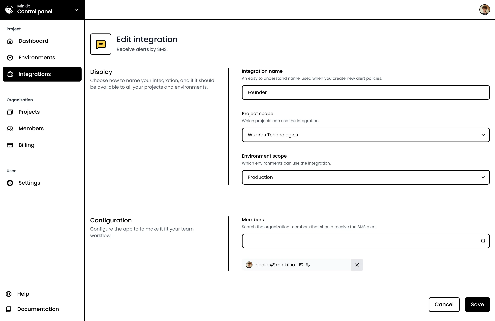
    </Frame>
</Update>

<Update label="May 10, 2023" id="improved-design" tags={["Phare news"]} rss={{ title: "Improved design", date: "2023-05-10" }}>
    ## Improved design

    The [home](https://phare.io) and [pricing](https://phare.io/pricing) pages got updated with a frostier design. A few other pages got updated as well to improve consistency across the website.

    <Frame>
        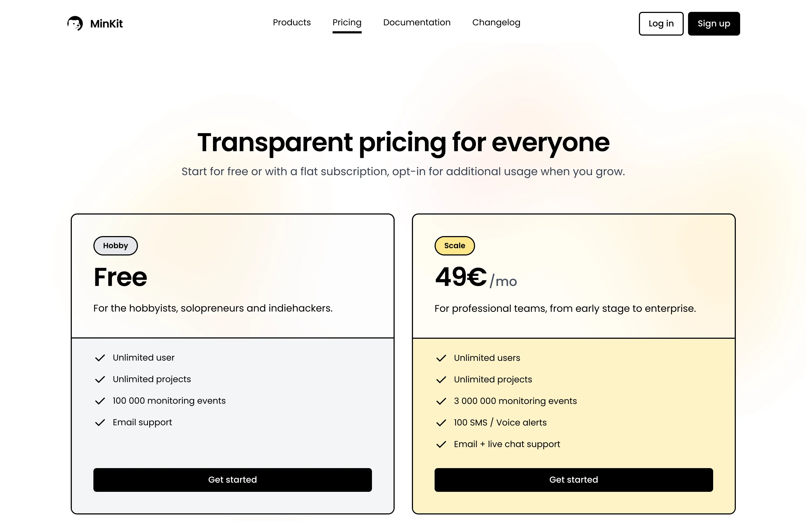
    </Frame>
</Update>

<Update label="May 5, 2023" id="public-launch" tags={["Phare news"]} rss={{ title: "Public launch", date: "2023-05-05" }}>
    ## Public launch

    The public launch on [ProductHunt](https://www.producthunt.com/posts/phare-uptime) went well, with the first unsolicited users signing up and using the platform. The platform has stayed stable and reliable, with only a few minor bugs reported and fixed since the launch.

    Thanks to everyone who voted on ProductHunt and participated in the launch.

    During the same period, the first paying customer joined, which is a great milestone for the project.

    <Frame>
        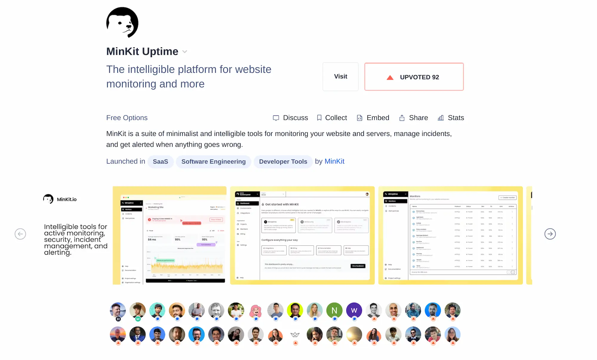
    </Frame>
</Update>

<Update label="May 4, 2023" id="documentation" tags={["Phare news"]} rss={{ title: "Documentation", date: "2023-05-04" }}>
    ## Documentation

    Documentation has been published. It is still a work in progress, but it is already a great resource to learn about what the platform has to offer and how to use it.

    <Frame>
        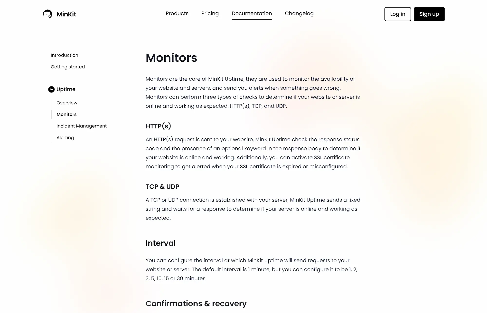
    </Frame>
</Update>

<Update label="Apr 14, 2023" id="new-monitor-alert-rules" tags={["Integrations"]} rss={{ title: "New monitor alert rules", date: "2023-04-14" }}>
    ## New monitor alert rules

    Two new alert rules have been added to receive alerts when a monitor is created or deleted

    <Frame>
        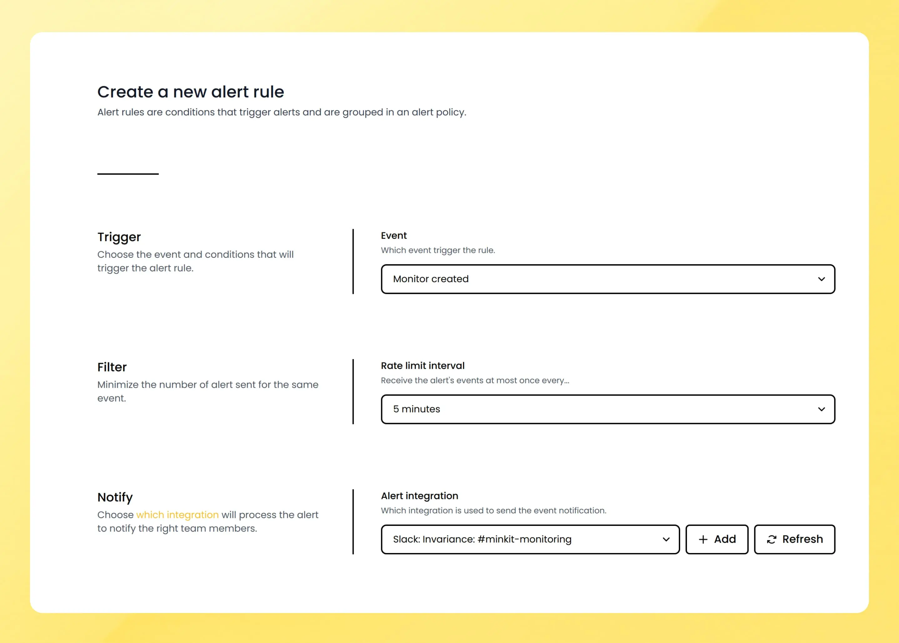
    </Frame>
</Update>

<Update label="Apr 10, 2023" id="bunny-cdn" tags={["Phare news"]} rss={{ title: "Bunny CDN", date: "2023-04-10" }}>
    ## Bunny CDN

    Phare migrated from [Cloudflare](https://www.cloudflare.com/) to [Bunny.net](https://bunny.net/). Bunny is a reliable content delivery platform with lightning-fast performance, making the platform even faster than before.

    <Frame>
        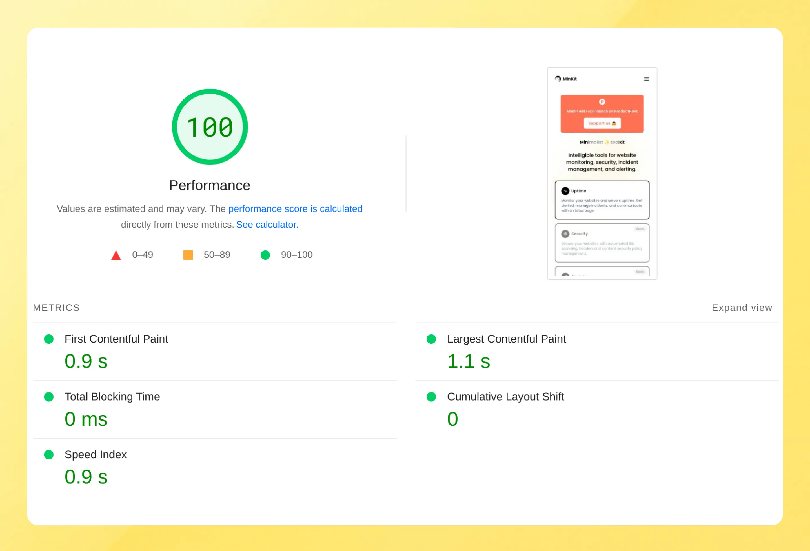
    </Frame>

    Speed is not the only reason for the migration. Bunny is a European Union company, based in Slovenia.

    This migration is part of Phare's effort to rely as much as possible on European providers and ensure maximum privacy for users.
</Update>

<Update label="Apr 9, 2023" id="billing-overage-management" tags={["Account"]} rss={{ title: "Billing overage management", date: "2023-04-09" }}>
    ## Billing overage management

    One feature was missing in the billing cycle released last week, managing overage, which occurs when your organization consumes more events than allowed in its subscription plan. You will now receive two emails, when 90% and 100% of your monthly allowed quota has been used. A free overage of 10 additional percent is offered before your account gets locked until the next billing period, or until you subscribe or upgrade your plan.

    <Frame>
        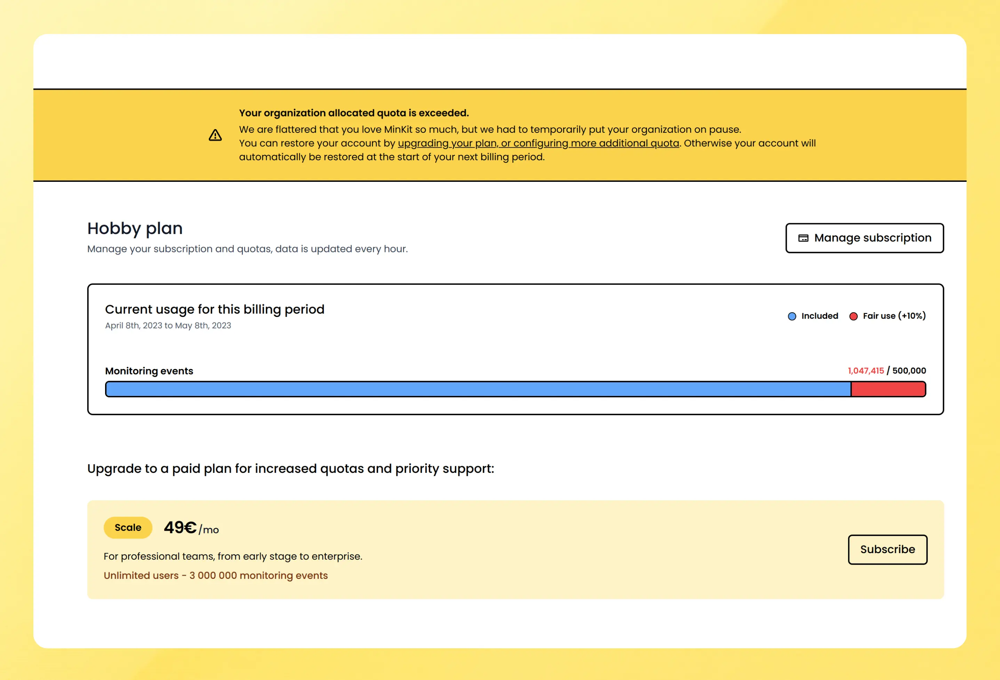
    </Frame>
</Update>

<Update label="Apr 8, 2023" id="end-of-beta" tags={["Phare news"]} rss={{ title: "End of beta", date: "2023-04-08" }}>
    ## End of beta

    With 3.5M checks successfully performed, 272 incidents reported, and 639 notifications sent, the platform is stable enough to end the beta program. The last 6 weeks have been productive, with lots of features and improvements on the platform, and a public launch is planned for early May.

    If you would like to support the launch on ProductHunt, you can [subscribe here to get notified](https://www.producthunt.com/products/phare).
</Update>

<Update label="Apr 6, 2023" id="paid-plan-activation" tags={["Account"]} rss={{ title: "Paid plan activation", date: "2023-04-06" }}>
    ## Paid plan activation

    With the end of the beta program incoming, the payment integration has been activated, which means no more unlimited usage on the free plan. Most of this week went into making sure the billing system was working as expected, and that monitoring events are reported fairly every month.
</Update>

<Update label="Apr 2, 2023" id="incidents-on-performance-chart" tags={["Monitors"]} rss={{ title: "Incidents on performance chart", date: "2023-04-02" }}>
    ## Incidents on performance chart

    A small change, but a welcome one to the performance chart, as you can now see incidents directly, and how they impact your website performance.

    <Frame>
        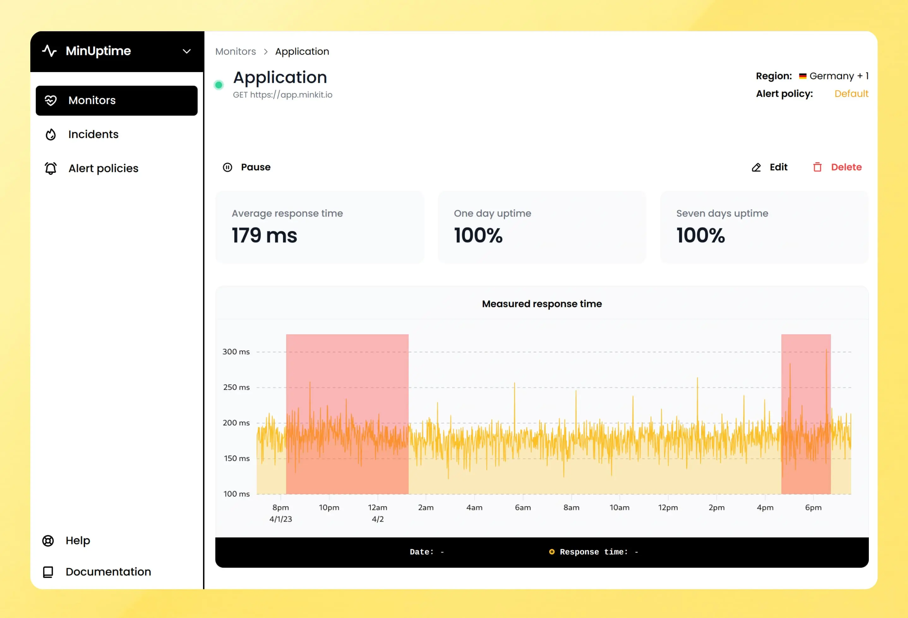
    </Frame>
</Update>

<Update label="Apr 1, 2023" id="frequently-asked-questions" tags={["Phare news"]} rss={{ title: "Frequently asked questions", date: "2023-04-01" }}>
    ## Frequently asked questions

    The pricing page now shows some frequently asked questions that should make everything clearer about how Phare works. This is a small first step toward fully fledged documentation.

    <Frame>
        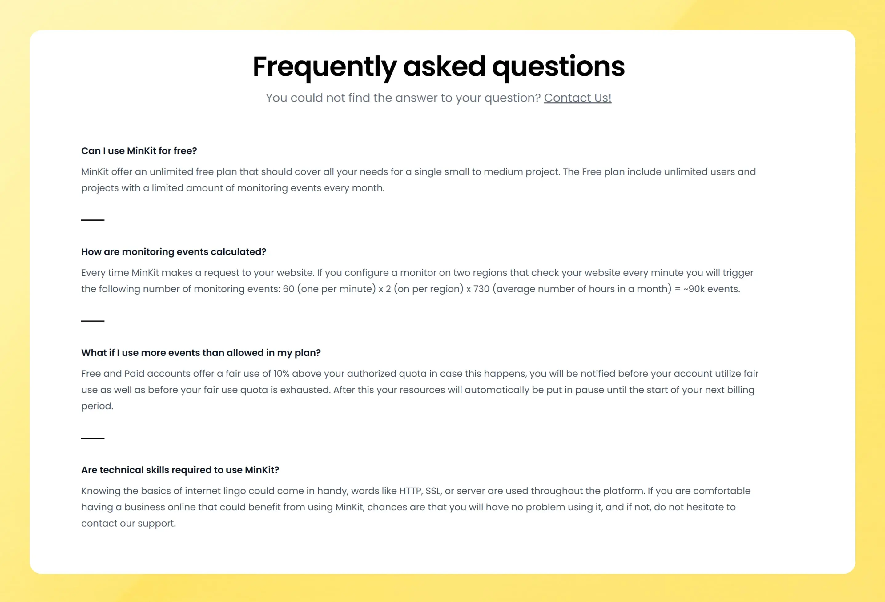
    </Frame>
</Update>

<Update label="Mar 28, 2023" id="stress-test" tags={["Phare news"]} rss={{ title: "Stress test", date: "2023-03-28" }}>
    ## Stress test

    To make sure that the platform continues to work flawlessly under load, thousands of test monitors have been created for a few days to expose any performance weaknesses. A few culprits were identified in how uptime averages were calculated and monitoring results stored, and those issues are now fixed.

    On older monitors, the statistic page could take up to a second to show, which is not on par with the rest of the platform in terms of performance. It has been improved and should now be displayed in under 100ms.
</Update>

<Update label="Mar 26, 2023" id="pagination" tags={["Dashboard"]} rss={{ title: "Pagination", date: "2023-03-26" }}>
    ## Pagination

    Dealing with so many monitors was impossible without a pagination, which is now active on most pages like projects, environments, monitors, incidents, and alert policies.

    <Frame>
        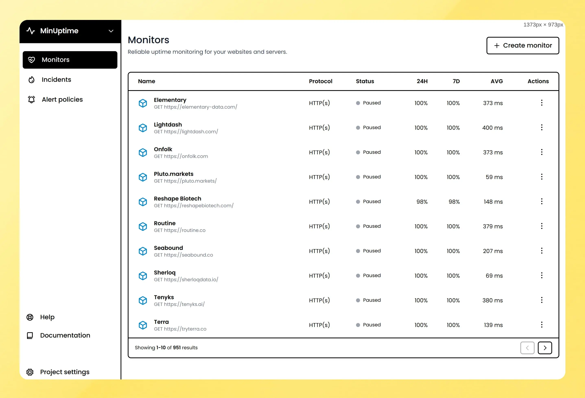
    </Frame>
</Update>

<Update label="Mar 24, 2023" id="authentication-pages-redesign" tags={["Dashboard"]} rss={{ title: "Authentication pages redesign", date: "2023-03-24" }}>
    ## Authentication pages redesign

    A small redesign of the authentication pages was made to make the pages more coherent with the overall design of the new landing pages created last week.

    <Frame>
        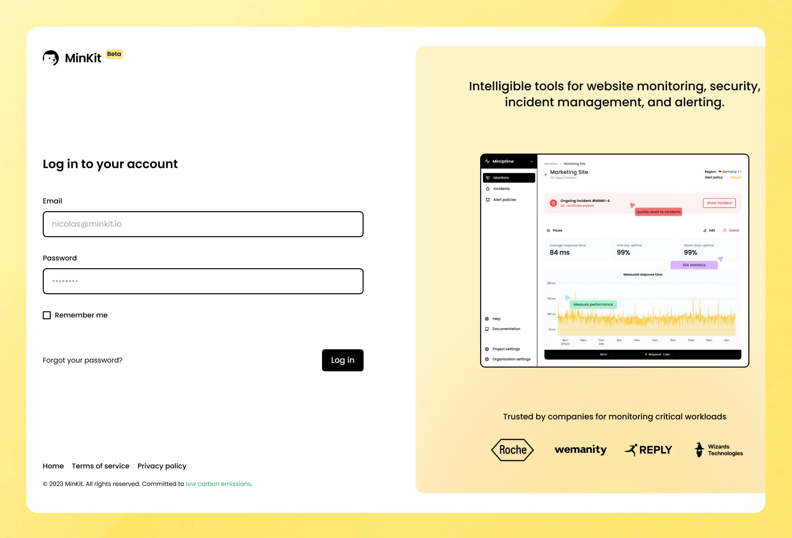
    </Frame>
</Update>

<Update label="Mar 22, 2023" id="legal" tags={["Phare news"]} rss={{ title: "Legal", date: "2023-03-22" }}>
    ## Legal

    Phare published the [terms of services](https://phare.io/legal/terms-of-service) and [privacy policy](https://phare.io/legal/privacy-policy). This was not the funniest task, but a necessary one as the open beta approached.
</Update>

<Update label="Mar 19, 2023" id="improved-billing" tags={["Account"]} rss={{ title: "Improved billing", date: "2023-03-19" }}>
    ## Improved billing

    Billing is not yet active during the private beta, giving time to make sure everything is simple and works as expected. Wording around plans, billing, and quotas have been reviewed and changed to make things easier to understand. The offer is also simplified with a limited free (Hobby) plan, and a single paid (Scale) plan. The paid plan, as the name suggests, grows with your organization needs thanks to additional quotas that can be configured.

    A detailed pricing calculator is now available on a new [pricing page](https://phare.io/pricing).

    The billing page presents a fresh look with more detailed information on included and additional usage for all products:

    <Frame>
        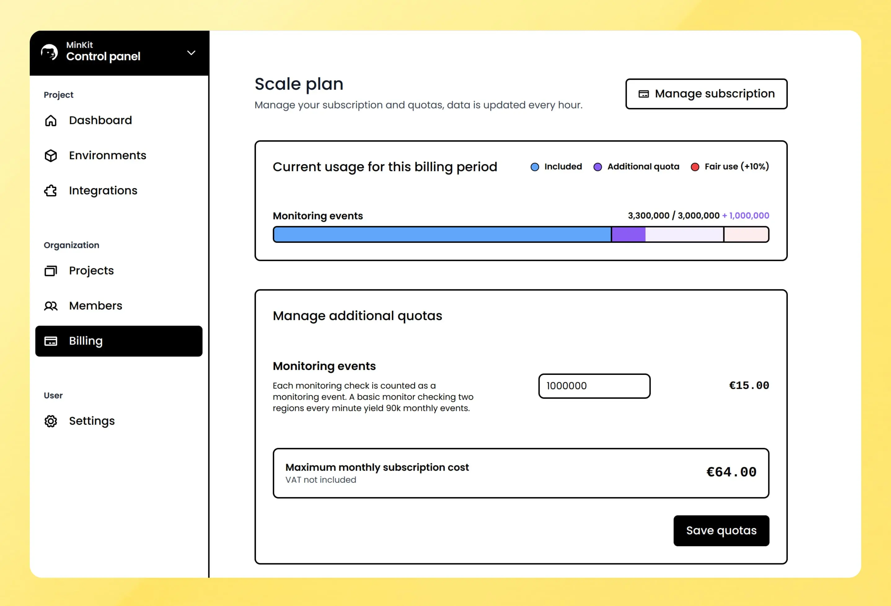
    </Frame>
</Update>

<Update label="Mar 15, 2023" id="members-management" tags={["Account"]} rss={{ title: "Members management", date: "2023-03-15" }}>
    ## Members management

    It is now possible to invite your colleagues to your organization, all accounts have unlimited numbers, the more, the merrier.

    <Frame>
        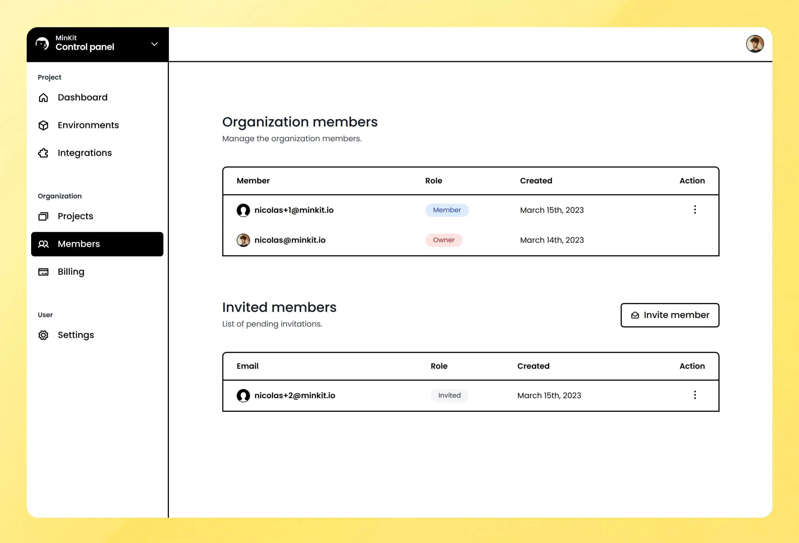
    </Frame>

    You can assign members to projects and choose who has access to a project during creation.

    <Frame>
        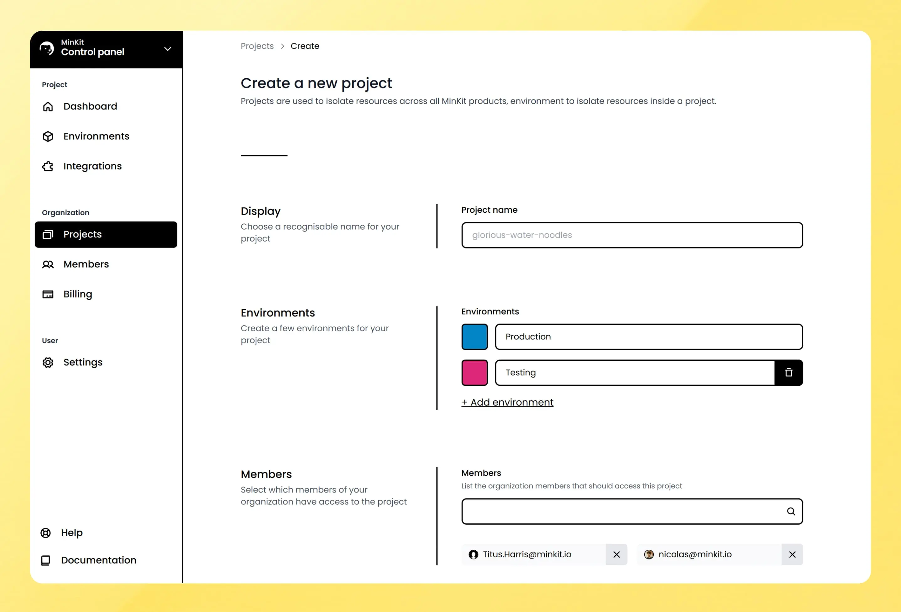
    </Frame>

    For now, all members can perform every possible action in the scope of their respective project. More granular role management will come later.
</Update>

<Update label="Mar 9, 2023" id="new-landing-page" tags={["Phare news"]} rss={{ title: "New landing page", date: "2023-03-09" }}>
    ## New landing page

    The landing page received a small makeover. A new marketing-oriented page has been created to present the Phare Uptime product with more details.

    Go check out the new [Phare Uptime landing page](https://phare.io/products/uptime).
</Update>

<Update label="Mar 9, 2023" id="new-alert-rules" tags={["Integrations"]} rss={{ title: "New alert rules", date: "2023-03-09" }}>
    ## New alert rules

    Two new rules have been added with the introduction of incident management, one that triggers when a new incident is created and one when an incident has recovered.

    <Frame>
        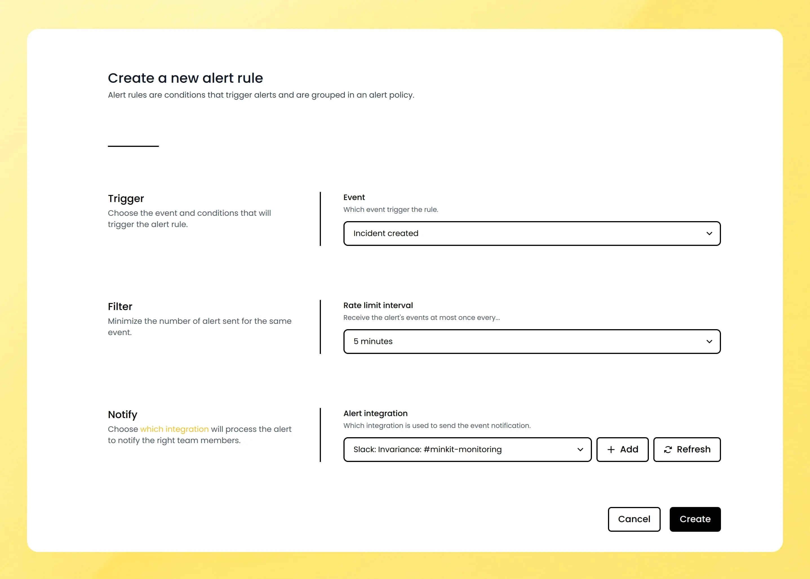
    </Frame>

    These two new rules replace the former `Monitor status changed` rule that no longer exists. All users' default alert policy rules have been updated to reflect this change.
</Update>

<Update label="Mar 8, 2023" id="incident-management" tags={["Incidents"]} rss={{ title: "Incident management", date: "2023-03-08" }}>
    ## Incident management

    Monitors now automatically create and resolve incidents, this behavior can be configured in each monitor's settings with two new parameters.

    - Incident confirmations: number of failing checks required before creating an incident.
    - Recovery confirmations: number of successful checks required before resolving an incident.

    <Frame>
        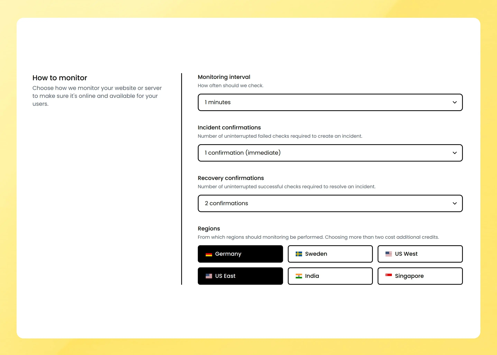
    </Frame>

    All incidents are shown in the incidents section of MinUptime, you can quickly see their status and act accordingly.

    <Frame>
        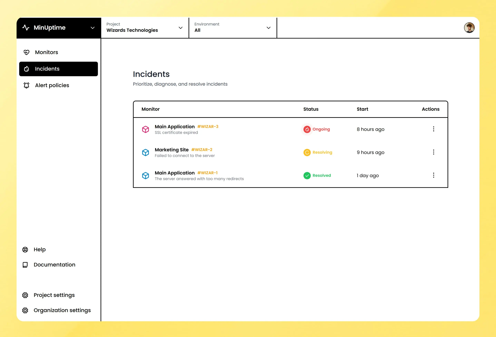
    </Frame>

    To help you fix the situation, a timeline of events linked to an incident is shown on the incident's page.

    <Frame>
        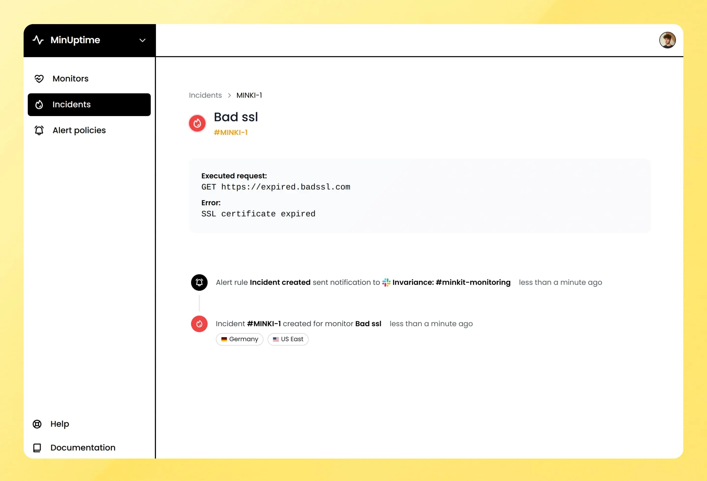
    </Frame>
</Update>

<Update label="Mar 6, 2023" id="discord-integration" tags={["Integrations"]} rss={{ title: "Discord integration", date: "2023-03-06" }}>
    ## Discord integration

    Discord is now an available integration, it can already be used for all types of alerts, and be configured to specific project and environments like the existing Slack and Email integration.

    <Frame>
        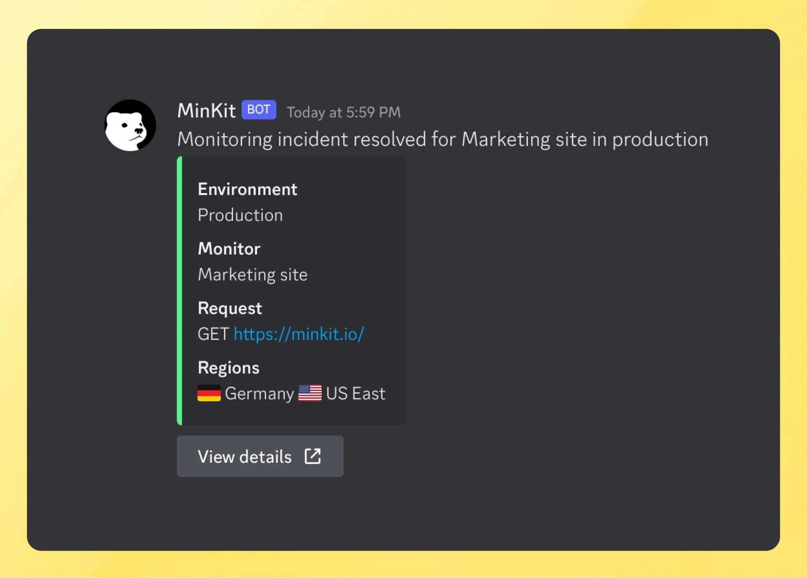
    </Frame>
</Update>

<Update label="Mar 2, 2023" id="timezone-and-time-format" tags={["Account"]} rss={{ title: "Timezone and time format", date: "2023-03-02" }}>
    ## Timezone and time format

    Users can now select their Timezone and preferred time format (24 or 12-hour clock)

    <Frame>
        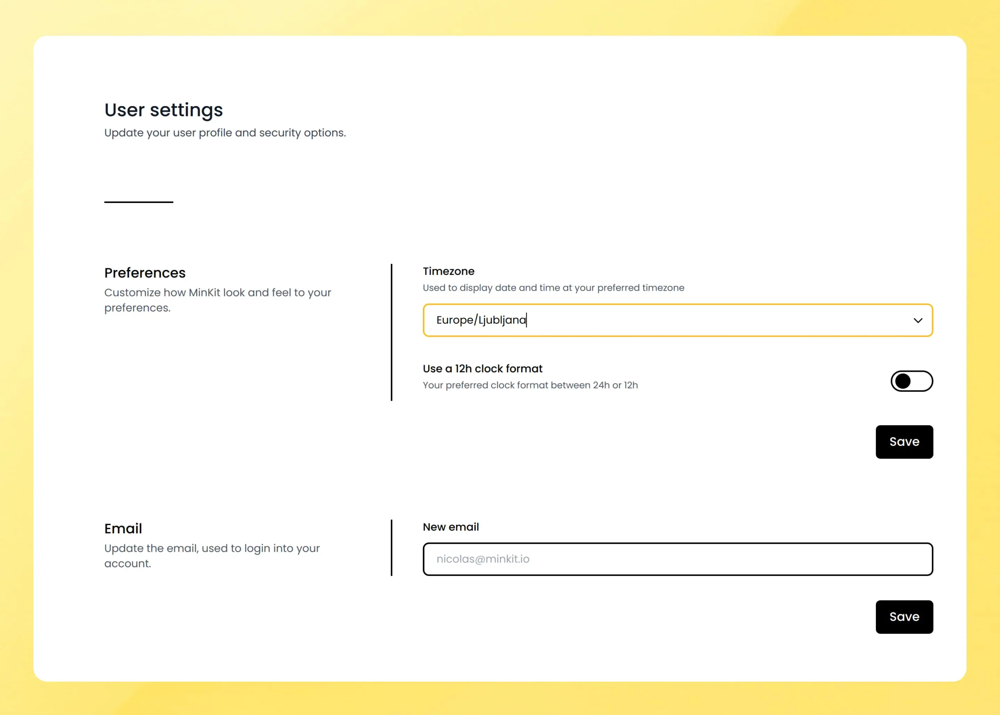
    </Frame>
</Update>
